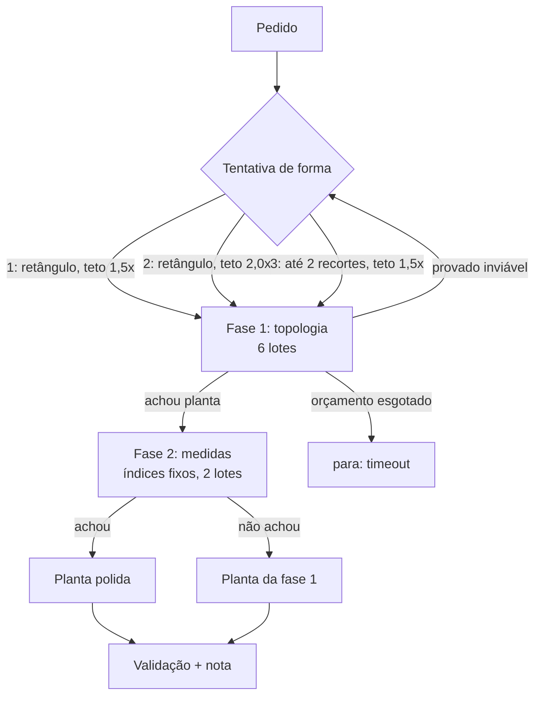

# Fundamentação teórica do gerador CP-SAT (M1)

> Criado em 2026-11-22 (S07) · Atualizado em 2026-11-24 (S08) · Versão 1.1: formas provadas inviáveis não se repetem (DEC-0126), motivo de menos de K plantas (DEC-0138) e `ortools` fixo (DEC-0137)
> Código de referência: `src/pygridplan/generators/cpsat.py`, `scoring/score.py`, `scoring/diversity.py` e `validation/` no estado do branch `fix/generator-adjustments` (DEC-0123, DEC-0126, DEC-0138).
> Documento de estudo e portfólio. Cada afirmação sobre o PyGridPlan aponta para o código ou para um teste. As afirmações sobre o CP-SAT e a literatura apontam para as referências da seção 10.

## Sumário

1. [O problema: cobertura exata numa malha de linhas de parede](#1-o-problema-cobertura-exata-numa-malha-de-linhas-de-parede)
2. [O solver: CP-SAT](#2-o-solver-cp-sat)
3. [Duas fases e tentativas de forma](#3-duas-fases-e-tentativas-de-forma)
4. [Critérios, pesos e a nota final](#4-critérios-pesos-e-a-nota-final)
5. [Diversidade e a proibição de espelho](#5-diversidade-e-a-proibição-de-espelho)
6. [Reprodutibilidade](#6-reprodutibilidade)
7. [Limitações conhecidas](#7-limitações-conhecidas)
8. [Comparação com as alternativas previstas](#8-comparação-com-as-alternativas-previstas)
9. [Mapa das afirmações para o código](#9-mapa-das-afirmações-para-o-código)
10. [Referências](#10-referências)

---

## 1. O problema: cobertura exata numa malha de linhas de parede

### 1.1 Do pedido ao problema combinatório

O pedido (`model/request.py`) traz o terreno (largura, profundidade, recuos, lados encostados, norte), a lista de cômodos com tipo e área-alvo opcional e as relações "perto/longe" com intensidade. O gerador precisa devolver, para cada cômodo, um retângulo alinhado aos eixos, de modo que:

- os retângulos não se sobreponham e caibam na área edificável;
- cada cômodo respeite a largura e a área mínimas do tipo (`data/`, via `model/catalog.py`);
- todo cômodo seja alcançável a partir da entrada, na frente do lote (design 5.1 e 5.5);
- a casa seja um bloco cheio, com paredes alinhadas (design 20.1).

Posicionar retângulos sem sobreposição é um problema de **empacotamento retangular**, NP-difícil no caso geral. A primeira versão do M1 modelava retângulos livres numa grade de 100 mm. A calibração do M1.1 mostrou que essa formulação travava: o solver gastava a busca em microajustes de medida e quase não trocava a topologia (`docs/plans/m1-1-calibration.md`, seção 3). Daí a reformulação atual.

### 1.2 A malha de linhas de parede

Em vez de coordenadas livres, a casa é uma **malha retangular de P × Q faixas**, com P, Q ≤ `MAX_LINES` = 6. As **linhas** da malha (X₀ < X₁ < … < X_P e Y₀ < … < Y_Q) são variáveis inteiras, em múltiplos de `GRID` = 100 mm. Duas linhas usadas consecutivas distam pelo menos `gap` = ⌈max(parede externa, 900 mm) / 100⌉ unidades (`cpsat.py`, `_phase`). Com a parede externa padrão de 150 mm, `gap` = 9, ou seja, 900 mm.

Cada cômodo é um **bloco de células** [c₁, c₂) × [r₁, r₂) da malha. Suas coordenadas reais saem das linhas por restrições `element`: x = X[c₁], x₂ = X[c₂] e o mesmo em y (classe `_Cell`).

```
        X0      X1        X2     X3
   Y3   +-------+---------+------+        P = 3 faixas em x, Q = 3 em y
        | quarto| banho   |quarto|        cada cômodo = bloco de células
   Y2   |   1   +---------+  2   |        as linhas Xk, Yk se movem;
        |       |  circ.  |      |        os índices (c1, c2, r1, r2) dizem
   Y1   +-------+---------+------+        quem fica ao lado de quem
        |   sala          |coz.  |
   Y0   +-----------------+------+   <- frente (rua), Y0 no recuo frontal
```

A separação entre **índices** (quem ocupa quais células, a topologia) e **linhas** (onde as paredes estão, as medidas) é o que permite as duas fases da seção 3.

### 1.3 Cobertura exata

Os blocos dos cômodos e até dois **recortes de borda** opcionais (`voids`) satisfazem:

1. **sem sobreposição:** `add_no_overlap_2d` sobre os intervalos de índices de todos os blocos;
2. **soma das células = p · q:** a soma das células de todos os blocos é igual ao número de células usadas da malha.

Sem sobreposição e com a soma igual ao total, os blocos **cobrem a malha exatamente**: é uma instância de **cobertura exata** (*exact cover*), um dos 21 problemas NP-completos de Karp [Karp 1972], conhecido em computação pelo algoritmo X com *dancing links* de Knuth [Knuth 2000]. A consequência prática é forte:

- **bloco cheio por construção:** não existe vazio entre cômodos, porque toda célula pertence a alguém;
- **paredes alinhadas por construção:** paredes de cômodos diferentes caem nas mesmas linhas da malha;
- **casa em L, T ou degrau** continua possível pelos recortes, mas eles precisam tocar a borda da malha (pelo menos um de c₁ = 0, c₂ = p, r₁ = 0 ou r₂ = q). Um pátio fechado no meio da casa é impossível.

O teste `test_generated_house_is_compact` e `test_benchmark_requests_give_full_block_with_sane_areas` (`tests/test_cpsat.py`) conferem o bloco cheio na saída.

### 1.4 Restrições geométricas e de programa

Todas em `_phase` (`cpsat.py`):

| Restrição | Formulação |
|---|---|
| Área edificável | domínio das linhas limitado pelos recortes e lados encostados; frente fixa no recuo frontal (`by1 == yr[0]`) |
| Implantação | centralizada na largura (diferença ≤ 1 unidade entre as folgas laterais) ou encostada no lado pedido |
| Lado mínimo | ⌈(largura mínima do tipo + parede) / 100⌉, e nunca menos que uma porta (900 mm + parede) |
| Área útil aproximada | a = (100·w − e)(100·h − e), em mm², com *e* = parede externa: desconta meia parede externa em todos os lados (conservador; a área real usa parede interna de 100 mm nos lados internos, `model/walls.py`) |
| Faixa de área | área mínima do tipo ≤ a; e, se houver alvo, 0,7 × alvo ≤ a ≤ teto (1,5 × ou 2,0 × o maior entre o alvo e o menor cômodo possível) |
| Proporção | lado maior ≤ 2,5 × lado menor nos cômodos internos (`MAX_ASPECT`) |
| Circulação | um dos lados ≤ 1,50 m (`CORRIDOR_MAX_WIDTH_MM`): é faixa, não enchimento |
| Representação única | as bordas esquerda, direita e do fundo tocam algum cômodo; cada linha interna usada é face de algum bloco; o 2º recorte só existe se o 1º existir |

A última linha é **quebra de simetria** [Gent, Petrie e Puget 2006]: sem ela, a mesma planta teria várias representações (uma linha "fantasma" que não separa nada, ou os dois recortes trocados), e o solver perderia tempo explorando cópias.

**Adjacência.** `touch(ci, cj)` é um booleano que implica parede comum: os blocos compartilham uma linha da malha e seus intervalos no outro eixo se sobrepõem. Como as linhas distam pelo menos 900 mm, qualquer trecho comum já comporta uma porta, e a adjacência pode ser decidida **só pelos índices**.

**Acesso local.** O cômodo de entrada (atravessável e que não seja circulação) toca a frente. Cada atravessável toca outro atravessável. Cada privativo toca a circulação (se for da zona íntima e houver circulação), um atravessável ou um cômodo que o aceite como suíte. A circulação liga pelo menos dois cômodos. Pelo menos um banheiro é social (`_social_bath_pairs`).

**Conectividade global por fluxo.** Adjacências locais não impedem "ilhas" de atravessáveis desconectadas da entrada. O modelo usa uma **formulação de fluxo de mercadoria única**, clássica em programação inteira: um cômodo-raiz na frente emite |T| − 1 unidades, cada outro atravessável consome uma, e só passa fluxo entre pares adjacentes. Se há fluxo viável, o grafo dos atravessáveis é conexo a partir da raiz.

**Janelas.** Para tipos com `window_need`, "ter janela" é tocar um lado externo da malha ou um recorte. É restrição dura para "obrigatória" (ou com `window_rule = "strict"`) e critério de nota para "preferida" (design 22.2).

Essas restrições são **condições necessárias**. A validação completa, independente do gerador, roda depois em `validate_geometry` e `check_access` (`validation/`), e uma planta reprovada é descartada (seção 5).

---

## 2. O solver: CP-SAT

### 2.1 O que é

O CP-SAT é o solver de programação por restrições do OR-Tools, do Google [OR-Tools CP-SAT; Perron, Didier e Gay 2023]. Ele trabalha só com **variáveis inteiras e booleanas** e combina três famílias de técnicas:

1. **Programação por restrições (CP):** cada restrição tem um propagador que poda os domínios das variáveis. Restrições globais como `NoOverlap2D` e `element` têm propagadores especializados.
2. **SAT com geração preguiçosa de cláusulas (*lazy clause generation*):** os domínios inteiros são codificados em literais booleanos sob demanda, e cada poda de um propagador vira uma cláusula explicada. Quando a busca chega a um conflito, o motor SAT aprende uma cláusula nova (CDCL) e salta para trás [Ohrimenko, Stuckey e Codish 2009]. O CP-SAT segue a linha do solver *chuffed* e acrescenta a ela um simplex e um portfólio de estratégias [Perron, Didier e Gay 2023].
3. **Relaxações lineares:** partes do modelo são linearizadas e resolvidas por simplex. Isso dá **limites duais** (o melhor valor ainda possível), que provam a otimalidade e podam ramos sem futuro [Perron, Didier e Gay 2023; Krupke, *CP-SAT Primer*].

### 2.2 Busca em portfólio paralela

Com `num_workers` > 1, o CP-SAT roda várias **estratégias de busca diferentes ao mesmo tempo**: buscas completas com heurísticas e relaxações distintas e, por padrão, workers de **busca em vizinhança grande** (LNS, *large neighborhood search* [Shaw 1998]), que fixam parte da melhor solução e re-resolvem o resto. Os workers trocam soluções, limites e cláusulas aprendidas. Vence o primeiro que provar o ótimo, ou a melhor solução quando o orçamento acaba [Krupke, *CP-SAT Primer*].

O PyGridPlan usa (`_phase`, fim da função):

| Parâmetro | Valor | Documentação (`sat_parameters.proto`, v9.15) |
|---|---|---|
| `num_workers` | 8 | número de workers paralelos |
| `interleave_search` | `True` | "intercala as principais estratégias de busca e distribui o trabalho entre os workers. A busca é determinística (independentemente de `num_workers`)": tarefas rodam em lotes, com sincronização entre eles |
| `max_num_deterministic_batches` | 6 (fase 1) / 2 (fase 2) | "para depois desse número de lotes agendados; só faz sentido com `interleave_search`" |
| `use_lns` | `False` | desliga todos os workers de LNS |
| `share_binary_clauses` | `False` | desliga a troca de cláusulas binárias aprendidas entre workers |
| `random_seed` | semente do pedido + nº da tentativa | reinicia o gerador aleatório interno |

A seção 6 explica por que o LNS e a troca de cláusulas binárias foram desligados.

### 2.3 Por que CP-SAT, e não MIP puro

As restrições do problema são majoritariamente **lógicas e disjuntivas**: "se o booleano *b* vale, então c₂ᵢ = c₁ⱼ e os intervalos se sobrepõem" (`only_enforce_if`), "pelo menos um destes lados é externo" (`add_bool_or`), "sem sobreposição em 2D". Num MIP, cada uma dessas implicações vira uma restrição *big-M*, com relaxação linear fraca. No CP-SAT, elas são nativas, e o aprendizado de cláusulas reaproveita os conflitos. Os produtos (área = w · h, células = largura · altura do bloco) entram por `add_multiplication_equality`, que o CP-SAT trata com propagação e linearização própria. Wu et al. [2018] mostram que um MIQP também resolve plantas de interiores; a escolha aqui foi pela expressividade lógica e por ser gratuito e offline (CLAUDE.md, princípios de arquitetura).

---

## 3. Duas fases e tentativas de forma

### 3.1 Fluxo geral



### 3.2 Fase 1: topologia

Decide **quem fica onde**: o número de faixas usadas (p, q) e os índices de todos os blocos. O objetivo é **só combinatório**, porque termos com produtos de variáveis grandes atrasavam a troca de topologia (`docs/plans/m1-1-calibration.md`, seção 4, "malha em uma fase só"):

- área: um booleano por cômodo com alvo, que vale se a área ficar entre 0,8 e 1,25 vez o alvo (`AREA_WINDOW`), com metade do peso `area_fit`;
- recortes: custo fixo por recorte existente e custo por célula (`VOID_FIXED`, `VOID_CELL`);
- linhas: `LINE_PRICE` por faixa usada (menos faixas = paredes mais alinhadas);
- os termos comuns às duas fases (seção 4.2).

### 3.3 Fase 2: medidas

Com os índices **fixos** (`m.add(var == value)` para p, q e todos os c₁, c₂, r₁, r₂), só as linhas se movem. Como a adjacência depende só dos índices, a topologia e todas as relações de vizinhança ficam congeladas. O objetivo passa a ser o **exato**:

- desvio absoluto de área de cada cômodo em relação ao alvo, com coeficiente igual ao maior entre o relativo (protege cômodos pequenos) e o absoluto (protege os grandes);
- área vazia: área da caixa envolvente menos a soma das áreas dos cômodos, com o peso inteiro da compacidade (`VOID_SCALE`).

O espaço de busca da fase 2 é pequeno (só as P + Q + 2 linhas), e na bancada ela provou o ótimo nas 20 alternativas (design 22.5). Se não terminar no orçamento, vale a planta da fase 1 (`_solve`: `polished or plan`).

Essa separação é uma **decomposição hierárquica**: primeiro a decisão discreta (topologia), depois a contínua (dimensões). Ela troca otimalidade global por velocidade: a fase 1 escolhe a topologia por um objetivo aproximado, e a fase 2 não pode mais mudá-la.

### 3.4 Tentativas de forma

`SHAPE_ATTEMPTS` = ((0, 1,5), (0, 2,0), (2, 1,5)), na forma (número máximo de recortes, teto de área como múltiplo do alvo). O gerador tenta, em ordem (`_solve`):

1. retângulo cheio, com teto de 1,5 × o alvo;
2. retângulo cheio, com teto de 2,0 ×;
3. até 2 recortes de borda (L, T, degrau), com teto de 1,5 ×.

Cada tentativa só roda se a anterior for **provada inviável** (`status == "infeasible"`). Se a anterior esgotar o orçamento sem provar nada, o gerador para. Isso é uma forma de **prioridade lexicográfica** entre objetivos: "retângulo" é mais importante que "área perto do alvo", que é mais importante que "sem recortes", e a prioridade não depende da calibração de pesos. Origem: a observação do responsável de que o recorte é "área perdida" e dificulta a obra (design 22.3, DEC-0099).

**Sem repetir provas (DEC-0126).** Da 2ª alternativa em diante, `_solve` começa pela tentativa em que a busca anterior parou (`first_shape`), e não pela primeira. É seguro por **monotonicidade**: cada alternativa tem as restrições da anterior mais os padrões proibidos novos, então o conjunto de soluções só encolhe, e uma forma provada inviável continua inviável. As plantas são as mesmas (`test_shapes_proven_infeasible_are_not_tried_again` compara com quem refaz todas as tentativas; a bancada dá 20 plantas iguais); só o tempo muda, e só nos pedidos que passam da primeira forma. A exceção teórica: se refazer a prova estourasse o orçamento, a geração antiga parava ali, e a nova pode entregar mais plantas.

Antes das tentativas de forma, se o pedido não tem lado encostado e nada coube, `_attach_if_needed` tenta encostar a casa nas divisas, em ordem: esquerda; esquerda e direita; esquerda, direita e fundo (design 20.1, item 5). A planta resultante leva o aviso `attached`.

---

## 4. Critérios, pesos e a nota final

### 4.1 Uma fonte única de pesos

`WEIGHTS` (`scoring/score.py`) é usado **tanto pela nota quanto pelo objetivo do solver**:

| Critério | Peso | O que mede na nota (`score_plan`) | Valor em [0, 1] |
|---|---|---|---|
| `relations` | 3,0 | relações "perto" atendidas por passagem e "longe" pela distância entre centros, ponderadas pela intensidade | média ponderada |
| `area_fit` | 2,0 | 1 − desvio relativo médio da área útil real em relação ao alvo | recortado em [0, 1] |
| `compactness` | 3,0 | área dos cômodos / área da caixa envolvente | razão |
| `circulation` | 1,0 | função × economia: fração dos privativos íntimos servidos pela circulação × (1 − área de circulação / área útil) | produto |
| `solar` | 1,0 | fração dos cômodos `sun` com fachada no lado norte | fração |
| `wet_grouping` | 0,5 | fração das áreas molhadas com vizinho molhado | fração |
| `alignment` | 1,0 | vizinhos com faces na mesma reta + cômodos do mesmo tipo com as mesmas medidas | fração |
| `zoning` | 2,0 | por onde se chega à circulação e aos cômodos de uso concentrado (`access_hub`: sala 1, cozinha 0,5) | média |
| `ventilation` | 1,0 | fração dos cômodos que precisam de janela com parede externa | fração |

### 4.2 O objetivo do solver

O objetivo é `maximize(sum(terms))`, com cada termo multiplicado pelo peso do critério correspondente. Termos comuns às duas fases: relações (booleano de adjacência para "perto"; distância de Manhattan entre centros, normalizada, para "longe"), cômodos gêmeos com as mesmas medidas, preço da área de circulação e de cômodos sem alvo (`UNTARGETED_PRICE`, senão eles incham para encher o bloco), janelas preferidas, zoneamento, sol e áreas molhadas. A diferença entre as fases está na seção 3.

### 4.3 A nota final

```
nota = Σ (valorᵢ × pesoᵢ) / Σ pesoᵢ ,  somando só os critérios que se aplicam ao pedido
```

É uma **soma ponderada normalizada**, o método escalar mais simples de otimização multiobjetivo [Marler e Arora 2010]. Um critério que não se aplica (sem circulação, sem norte, sem relações) sai do numerador e do denominador, e a nota continua em [0, 1]. A nota é sempre mostrada decomposta por critério (`Score.criteria`).

### 4.4 Diferenças entre o objetivo e a nota (fatos a ter em mente)

O objetivo do solver é uma **aproximação** da nota, não uma cópia:

- **área:** o solver usa a área conservadora (meia parede externa em todos os lados); a nota usa a área útil real, com parede interna de 100 mm nos lados internos. Na fase 1, o solver nem mede desvio: só premia a janela de 0,8 a 1,25;
- **circulação:** o critério de nota (função × economia) não tem termo próprio no solver; a função vem das restrições duras de acesso, e a economia, do preço por área;
- **compacidade:** na fase 1 vem dos custos de recorte; na fase 2, da área vazia da caixa. Sem recortes, a cobertura exata já dá compacidade 1;
- **alinhamento:** o solver só premia os gêmeos (mesmo alvo, w = w e h = h); a nota aceita a orientação trocada, ignora o alvo e conta o alinhamento de faces vizinhas, que no solver sai da malha;
- **áreas molhadas:** o solver soma os **pares** adjacentes; a nota usa a fração de **cômodos** com vizinho molhado;
- **preços** por faixa de malha e por área sem alvo (`LINE_PRICE`, `UNTARGETED_PRICE`) não existem na nota.

Consequência: a melhor planta para o solver não é, garantidamente, a de maior nota. As duas medidas apontam na mesma direção por construção, mas a nota é a palavra final.

### 4.5 O que a teoria diz sobre a soma ponderada

- **Fato:** a soma ponderada só alcança soluções na parte **convexa** da fronteira de Pareto. Soluções eficientes em regiões côncavas não são ótimas para nenhum vetor de pesos [Marler e Arora 2010].
- **Fato:** os pesos atuais foram calibrados pelo agente na bancada de 5 pedidos (DEC-0089 a DEC-0091), não estimados a partir de preferências medidas de usuários.
- **Divergência registrada:** o design previa utilidade com retornos decrescentes por critério; o código do M1 é linear (docstring de `score.py`). Na S08, o design 5.6 passou a descrever o código, e o tema volta no M3 e no M7 (DEC-0138). Choquet e Pareto ficaram para depois do MVP (design 5.6).

---

## 5. Diversidade e a proibição de espelho

### 5.1 O padrão de posições relativas

Para cada par de cômodos (i, j), `relative_pattern` guarda quatro booleanos: i à esquerda de j, à direita, à frente, atrás (`scoring/diversity.py`). Dois pares **diferem de verdade** se nenhuma relação que valia numa planta vale na outra. Ficar "à direita e também atrás" em vez de só "à direita" não conta como diferença (`test_diagonal_flip_is_not_a_real_difference`).

### 5.2 Geração sequencial com padrões proibidos

`generate_alternatives` gera K alternativas (padrão 4) assim:

1. resolve sem restrição de diversidade;
2. guarda o padrão da planta em `seen`, **mesmo que ela seja reprovada** na validação;
3. resolve de novo com a restrição: para cada padrão proibido, pelo menos `min_diff` pares precisam diferir de verdade, com `min_diff` = max(1, ⌈0,15 · C(n, 2)⌉) (`MIN_DIFF_FRACTION`);
4. repete até ter K plantas válidas, até 20 tentativas, ou até o solver não achar mais nada.

Quando entrega menos de K, diz o motivo em todas as plantas (aviso `fewer_alternatives`) e na CLI. Os três motivos (`STOP_REASONS`) têm significados lógicos diferentes (DEC-0138):

| Parada | O que se sabe | O que fazer |
|---|---|---|
| `infeasible` | **prova** de que nenhuma planta do modelo difere o bastante das já vistas | mais lotes nesta resolução não ajudam; outra semente (as plantas já vistas mudam) ou outro pedido pode dar outro conjunto |
| `timeout` | nada: a busca parou no orçamento sem achar nem provar | aumentar `--batches` |
| `attempts` | 20 resoluções gastas: K passa de 20, ou muitas plantas foram reprovadas na validação | pedir menos plantas, ou rever o programa |

A prova vale dentro do modelo: a malha de até 6 × 6, as três formas, o teto de área e a implantação usada.

No modelo, cada par tem quatro literais (`lo <= hi`), e um booleano *d* "difere" implica a negação de cada relação que valia no padrão antigo. É uma generalização das **restrições *no-good*** da programação por restrições: em vez de proibir uma única atribuição, proíbe-se uma vizinhança inteira (tudo o que estiver a menos de `min_diff` pares de distância). Hebrard et al. [2005] formalizam esse tipo de problema ("encontrar k soluções diversas") e propõem métodos para ele, alguns com restrições globais de diversidade. A geração sequencial usada aqui é a versão **gulosa**: acha uma solução por vez, exigindo distância das anteriores.

Cada tentativa usa a semente `seed + attempt`, o que varia a busca sem quebrar a reprodutibilidade.

### 5.3 A proibição de espelho

O espelho de uma planta na largura troca "esquerda" por "direita" em todos os pares e mantém frente e fundo, porque a frente é sempre a rua (`mirrored`). A cada tentativa, a lista proibida é `seen + [mirrored(s) for s in seen]`: o espelho de toda planta já vista também é proibido, **sempre**, inclusive com a casa encostada num lado só (design 22.4, DEC-0100). O motivo é de produto: o responsável viu alternativas espelhadas como repetidas.

Do ponto de vista teórico, é **quebra de simetria entre soluções**: a reflexão horizontal é uma simetria do problema quando o lote é simétrico, e proibir a imagem de cada solução vista corta essa simetria de forma dinâmica [Gent, Petrie e Puget 2006]. Quando o lote não é simétrico (casa encostada, norte lateral), o espelho seria outra planta válida, e a proibição é uma escolha de produto, não uma simetria matemática.

### 5.4 A escolha gulosa e a alternativa

Até a S08, o design 9 propunha escolher as K alternativas **maximizando a menor distância entre pares** entre candidatas válidas acima de um piso de nota. O código faz a versão **gulosa e sequencial**, com uma distância mínima fixa (15 % dos pares). A versão gulosa não garante o conjunto mais diverso, mas cada alternativa nova sai ótima (ou a melhor no orçamento) dentro do que ainda é permitido. O design 9 agora descreve a versão gulosa, e a alternativa volta no M3 e no M7 (DEC-0138).

---

## 6. Reprodutibilidade

### 6.1 O contrato

O mesmo pedido, com a mesma semente e o mesmo orçamento, dá as mesmas plantas, inclusive quando a busca para sem provar o ótimo e com a máquina carregada (design 22.5, DEC-0123). Testes: `test_same_seed_same_plans` e `test_same_request_same_plans_when_the_search_stops_at_its_budget` (`tests/test_generate.py`). Este último roda duas gerações simultâneas da casa grande, confere que alguma resolução parou no orçamento e exige plantas iguais.

### 6.2 Por que um solver paralelo varia

Num portfólio paralelo comum, as threads trocam informação no momento em que a encontram. O momento depende do escalonamento do sistema operacional, então a mesma execução, repetida, segue caminhos diferentes. Se a busca prova o ótimo, o **valor** do objetivo é o mesmo, mas a planta pode ser outra entre as empatadas. Se para no limite, até o valor muda.

### 6.3 Como o PyGridPlan garante o contrato

O modo `interleave_search` agenda as tarefas em **lotes** e sincroniza entre eles: o resultado não depende de quantas threads existem nem de qual terminou primeiro (comentário do `sat_parameters.proto`, v9.15). Três ajustes completam a garantia (DEC-0123):

| Ajuste | Por quê (medido na S07) |
|---|---|
| parar por **número de lotes** (`max_num_deterministic_batches`), não por tempo de relógio nem por tempo determinístico | o limite de tempo determinístico só é checado entre lotes e caía em lotes diferentes |
| `use_lns = False` | o LNS variava mesmo numa thread só; só com ele desligado as execuções saíram idênticas |
| `share_binary_clauses = False` | a troca de cláusulas binárias acontece fora dos pontos de sincronização |

O código do OR-Tools v9.15 reconhece essa lacuna num comentário de `FullProblemSolver` em `ortools/sat/cp_model_solver.cc` ("Fix that so we can have a deterministic parallel mode"), citado no design 22.5.

**Custo:** ≈ 19 % mais tempo na bancada (381 → 454 s para 5 pedidos × 4 alternativas), sem piora de nota (tabela na DEC-0123).

### 6.4 Limites da garantia

- Medida com o OR-Tools 9.15.6755 numa máquina Windows x86-64. O `pyproject.toml` fixa essa versão (DEC-0137); outra versão ou outro processador pode mudar a planta. Uma atualização passa antes pelo teste de reprodutibilidade.
- É reprodutibilidade **dada a mesma entrada**. Uma mudança pequena no pedido (1 m² a mais num cômodo) pode mudar a topologia inteira: o gerador não é contínuo em relação à entrada.

---

## 7. Limitações conhecidas

Fatos do código e das medições, em ordem de impacto:

1. **Tempo acima da meta.** O design 8 pede ~20 s para 4 alternativas de 8 a 12 cômodos. A casa grande leva ≈ 151 s. Não repetir as formas provadas inviáveis (DEC-0126) cortou 26 % do lote pequeno (54 → 40 s, medianas de 3 execuções) e ficou dentro do ruído (±3 %) nos outros quatro pedidos, que se resolvem na primeira forma (DEC-0149).
2. **Sem otimalidade garantida.** Nos pedidos maiores, a fase 1 para no orçamento sem provar o ótimo (10 das 20 alternativas da bancada, design 22.5). A decomposição em duas fases também fixa a topologia antes de medir.
3. **O encosto automático passa por cima de um orçamento esgotado.** Se uma implantação encostada para sem prova, `_attach_if_needed` tenta a próxima, que encosta mais. Só quando nenhuma dá planta o erro diz que o orçamento esgotou, e não que o programa não cabe (DEC-0149).
4. **Expressividade da malha.** No máximo 6 × 6 faixas e cômodos retangulares: um cômodo em L é impossível. Linhas a ≥ 900 mm umas das outras impedem degraus menores que isso. A malha representa arranjos que não são de guilhotina (o "cata-vento" de quatro cômodos em volta de um central cabe numa malha 3 × 3), mas não arranjos fora da grade comum.
5. **Restrições necessárias, não suficientes.** O acesso no solver é potencial (paredes comuns ≥ 900 mm); portas e janelas reais ficam para o M2/M4. A validação independente pode reprovar uma planta, que então consome uma das 20 tentativas.
6. **Objetivo ≠ nota.** Seção 4.4.
7. **Pesos e constantes calibrados pelo agente** na bancada de 5 pedidos, sem validação com usuários (`docs/plans/m1-1-calibration.md`, seção 5: "não são dados de norma").
8. **Diversidade gulosa** e com limiar fixo (seção 5.4).
9. **Um pavimento só**, terreno retangular, casa sempre paralela à frente.
10. **Reprodutibilidade presa à versão** do OR-Tools (seção 6.4).

---

## 8. Comparação com as alternativas previstas

A ordem dos geradores foi aprovada na DEC-0050: CP-SAT, árvore de subdivisão (M7) e, depois do MVP, crescimento em grade e recozimento simulado. Os três são descritos aqui pelo que a literatura diz deles. **Nenhum foi implementado no PyGridPlan**, e as linhas "esperado" são hipóteses a conferir no comparativo do M7.

### 8.1 Árvore de subdivisão

Corta o retângulo da casa recursivamente, seguindo uma hierarquia (zona social / íntima / serviço → cômodos). Marson e Musse [2010] fazem isso com o algoritmo de *treemaps* quadrados [Bruls, Huizing e van Wijk 2000], que escolhe cortes para manter os retângulos próximos de quadrados, e geram plantas em tempo real.

- **Garante:** bloco cheio (os cortes particionam o retângulo) e áreas proporcionais às pedidas.
- **Limita:** só gera plantas **de guilhotina** (cada corte atravessa o retângulo inteiro); adjacências e acesso não são garantidos pela construção e precisam de correção posterior.

### 8.2 Crescimento em grade

Coloca uma "semente" por cômodo numa grade de células e expande os cômodos, primeiro em retângulo e depois em L, até preencher o espaço. Lopes et al. [2010] propõem esse método com restrições definidas pelo usuário e o descrevem como mais flexível e mais rápido que técnicas de resolução de restrições.

- **Garante:** preenchimento e rapidez.
- **Limita:** a qualidade depende da posição das sementes; cômodos não retangulares são comuns; não há prova de otimalidade, e restrições duras (mínimos, acesso) são tratadas por heurística ou rejeição.

### 8.3 Recozimento simulado

Busca local estocástica: parte de uma planta, propõe movimentos (trocar dois cômodos, mover uma parede) e aceita pioras com probabilidade e^(−Δ/T), com a "temperatura" T caindo ao longo do tempo [Kirkpatrick, Gelatt e Vecchi 1983]. Merrell, Schkufza e Koltun [2010] geram plantas residenciais combinando um modelo probabilístico aprendido de dados (para o programa) com otimização estocástica (para o arranjo).

- **Garante:** aceita qualquer função de custo, inclusive não linear (a nota inteira, com retornos decrescentes ou Choquet).
- **Limita:** restrições duras viram penalidades; o resultado depende da semente e do resfriamento; não prova otimalidade nem inviabilidade.

### 8.4 Quadro comparativo

| Propriedade | CP-SAT em malha (atual) | Árvore de subdivisão | Crescimento em grade | Recozimento simulado |
|---|---|---|---|---|
| Restrições duras (mínimos, acesso, janela) | garantidas pelo modelo | tratadas depois | heurística / rejeição | penalidade |
| Bloco cheio | por construção | por construção | em geral | só se penalizado |
| Topologias | qualquer arranjo da malha 6 × 6, inclusive não guilhotina | só guilhotina | livre, inclusive L | livre |
| Prova de ótimo / de inviabilidade | sim, quando termina | não | não | não |
| Objetivo | linear nos termos do modelo | implícito na ordem dos cortes | implícito nas regras de crescimento | qualquer função |
| Velocidade | lenta para 8–12 cômodos (seção 7) | rápida, segundo os autores | rápida, segundo os autores | ajustável pelo resfriamento |
| Reprodutível | sim, com a configuração da DEC-0123 | sim, se determinística | com semente fixa | com semente fixa |
| Diversidade | padrões proibidos (seção 5) | variar a árvore | variar as sementes | variar as sementes |

A interface comum dos geradores (design 8) e o validador independente (design 5.1) permitem pôr os quatro lado a lado com a **mesma nota** no M7. A hipótese a testar ali: a subdivisão será muito mais rápida e menos fiel às restrições de acesso; o recozimento poderá otimizar a nota exata, que o CP-SAT só aproxima.

---

## 9. Mapa das afirmações para o código

| Afirmação | Onde conferir |
|---|---|
| Malha de linhas, `GRID`, `MAX_LINES`, `gap` | `cpsat.py`, constantes e início de `_phase` |
| Blocos e coordenadas por `element` | `cpsat.py`, classe `_Cell` |
| Cobertura exata (`add_no_overlap_2d` + soma das células) | `cpsat.py`, `_phase`, após os recortes |
| Recortes só na borda, quebra de simetria | `cpsat.py`, `_phase`, laço `for v in range(max_voids)` e "cada linha interna usada é face" |
| Conectividade por fluxo | `cpsat.py`, `_phase`, bloco "conectividade global" |
| Duas fases | `cpsat.py`, `_solve` e `topo_phase` em `_phase` |
| Tentativas de forma, sem repetir as inviáveis | `cpsat.py`, `SHAPE_ATTEMPTS` e `_solve` (`first_shape`) |
| Parâmetros do CP-SAT | `cpsat.py`, fim de `_phase` |
| Pesos e nota | `scoring/score.py`, `WEIGHTS` e `score_plan` |
| Padrões, espelho, distância | `scoring/diversity.py` |
| Alternativas, proibições e motivo de menos de K | `cpsat.py`, `generate_alternatives` e `STOP_REASONS` |
| Testes de reprodutibilidade | `tests/test_generate.py` |
| Testes de forma, acesso e circulação | `tests/test_cpsat.py` |

---

## 10. Referências

**OR-Tools e CP-SAT**

- Google. *CP-SAT Solver*, documentação do OR-Tools. <https://developers.google.com/optimization/cp/cp_solver>
- Google. `ortools/sat/sat_parameters.proto`, tag v9.15 (comentários de `num_workers`, `interleave_search`, `max_num_deterministic_batches`, `use_lns`, `share_binary_clauses`, `random_seed`). <https://github.com/google/or-tools/blob/v9.15/ortools/sat/sat_parameters.proto>
- Google. `ortools/sat/cp_model_solver.cc`, tag v9.15 (comentário em `FullProblemSolver`). <https://github.com/google/or-tools/blob/v9.15/ortools/sat/cp_model_solver.cc>
- Perron, L.; Didier, F.; Gay, S. *The CP-SAT-LP Solver* (palestra convidada). CP 2023, LIPIcs vol. 280, 3:1–3:2. DOI [10.4230/LIPIcs.CP.2023.3](https://doi.org/10.4230/LIPIcs.CP.2023.3)
- Krupke, D. *The CP-SAT Primer: Using and Understanding Google OR-Tools' CP-SAT Solver* (CC BY 4.0). <https://d-krupke.github.io/cpsat-primer>

**Programação por restrições e combinatória**

- Ohrimenko, O.; Stuckey, P. J.; Codish, M. Propagation via lazy clause generation. *Constraints* 14(3):357–391, 2009. DOI [10.1007/s10601-008-9064-x](https://doi.org/10.1007/s10601-008-9064-x)
- Shaw, P. Using constraint programming and local search methods to solve vehicle routing problems. CP 1998, LNCS 1520, p. 417–431.
- Gent, I. P.; Petrie, K. E.; Puget, J.-F. Symmetry in constraint programming. In: Rossi, F.; van Beek, P.; Walsh, T. (eds.). *Handbook of Constraint Programming*. Elsevier, 2006, cap. 10.
- Hebrard, E.; Hnich, B.; O'Sullivan, B.; Walsh, T. Finding diverse and similar solutions in constraint programming. AAAI 2005, p. 372–377. <https://cgi.cse.unsw.edu.au/~tw/hhowaaai05.pdf>
- Karp, R. M. Reducibility among combinatorial problems. In: Miller, R. E.; Thatcher, J. W. (eds.). *Complexity of Computer Computations*. Plenum, 1972, p. 85–103.
- Knuth, D. E. Dancing links. In: *Millennial Perspectives in Computer Science*, 2000. arXiv: [cs/0011047](https://arxiv.org/abs/cs/0011047)

**Otimização multiobjetivo e metaheurísticas**

- Marler, R. T.; Arora, J. S. The weighted sum method for multi-objective optimization: new insights. *Structural and Multidisciplinary Optimization* 41:853–862, 2010.
- Kirkpatrick, S.; Gelatt, C. D.; Vecchi, M. P. Optimization by simulated annealing. *Science* 220(4598):671–680, 1983. DOI [10.1126/science.220.4598.671](https://doi.org/10.1126/science.220.4598.671)

**Geração de plantas**

- Marson, F.; Musse, S. R. Automatic real-time generation of floor plans based on squarified treemaps algorithm. *International Journal of Computer Games Technology*, 2010, 624817. DOI [10.1155/2010/624817](https://doi.org/10.1155/2010/624817)
- Bruls, M.; Huizing, K.; van Wijk, J. J. Squarified treemaps. VisSym 2000, p. 33–42. DOI 10.2312/VisSym/VisSym00/033-042
- Lopes, R.; Tutenel, T.; Smelik, R. M.; de Kraker, K. J.; Bidarra, R. A constrained growth method for procedural floor plan generation. GAME-ON 2010. <https://graphics.tudelft.nl/~rafa/myPapers/bidarra.GAMEON10.pdf>
- Merrell, P.; Schkufza, E.; Koltun, V. Computer-generated residential building layouts. *ACM Transactions on Graphics* 29(6), 181:1–181:12, 2010 (SIGGRAPH Asia). DOI [10.1145/1866158.1866203](https://doi.org/10.1145/1866158.1866203)
- Wu, W.; Fan, L.; Liu, L.; Wonka, P. MIQP-based layout design for building interiors. *Computer Graphics Forum* 37(2):511–521, 2018. DOI [10.1111/cgf.13380](https://doi.org/10.1111/cgf.13380)

**Documentos do projeto**

- `docs/design/mvp.md`, seções 5, 8, 9, 20 a 22.
- `docs/plans/m1-1-calibration.md`, seções 3 a 5.
- `DECISOES.md`: DEC-0050, DEC-0089 a DEC-0101, DEC-0123, DEC-0126, DEC-0137, DEC-0138.
